  

  
  
  

 cat sobre_mim.txt" width="100%"/>

Olá! Me chamo **Josué**, sou estudante de **Análise e Desenvolvimento de Sistemas na FIAP**.

Atualmente desenvolvo skills em **Java, Python, banco de dados, IA, chatbots e Business Model** criando projetos práticos que resolvem problemas reais. Também tenho conhecimento em **marketing digital e design**, o que amplia minha visão sobre produto, experiência do usuário e soluções digitais.

🕷️ Busco oportunidades para aprender na prática, participar de projetos e evoluir na área de tecnologia. Aberto a conexões com profissionais de desenvolvimento e inovação.

 ls ./tecnologias" width="100%"/>

  

 git log --stats" width="100%"/>

  
  

  

 tail -f atividade.log" width="100%"/>

  

  

 ls ./projetos" width="100%"/>

### 🌱 SoulUp — Avatar Inteligente e Sustentável
`Challenge FIAP 2026` · `Grupo Dome`

Rede social sustentável em que cada pessoa tem um avatar que evolui conforme realiza ações sustentáveis reais: missões geram Ecoa Points, o avatar sobe de nível, conquista selos e personaliza o visual na loja.

- 🕸️ **Front-end:** React + TypeScript + Tailwind, com simulador interativo do avatar → [ver site](https://soul-up-sprint-4.vercel.app/)
- ☕ **Back-end:** API RESTful em Java com Spring Boot e Oracle, publicada no Render
- 🐍 **Python:** CRUD em Oracle, consumo de API pública e exportação em JSON

     

### ⚡ Pokédex API
`Checkpoint · Domain Driven Design Using Java`

API RESTful de cadastro de Pokémons com CRUD completo, arquitetura em camadas (Resource → BO → DAO → Oracle) e deploy no Render.

- 📂 [Repositório](https://github.com/josue-menezes/pokedex-api) · 🔗 [API no ar](https://pokedex-api-pepl.onrender.com/pokedex)

  

### 🃏 Pokédex TCG
`Checkpoint · Front-End Design Engineering`

Coleção de cartas favoritas integrada à API Pokémon TCG, com login validado no servidor, sessão em cookie e rotas protegidas.

- 📂 [Repositório](https://github.com/josue-menezes/cp-pokemon-tcg) · 🔗 [ver site](https://cp-pokemon-tcg.vercel.app)

  

### 📚 StudyLog `em construção`
App para registrar sessões de estudo, feito com Java, Spring Boot e Angular.

- 📂 [Repositório](https://github.com/josue-menezes/studylog)

  

🕷️ Cards atualizados automaticamente todos os dias.

